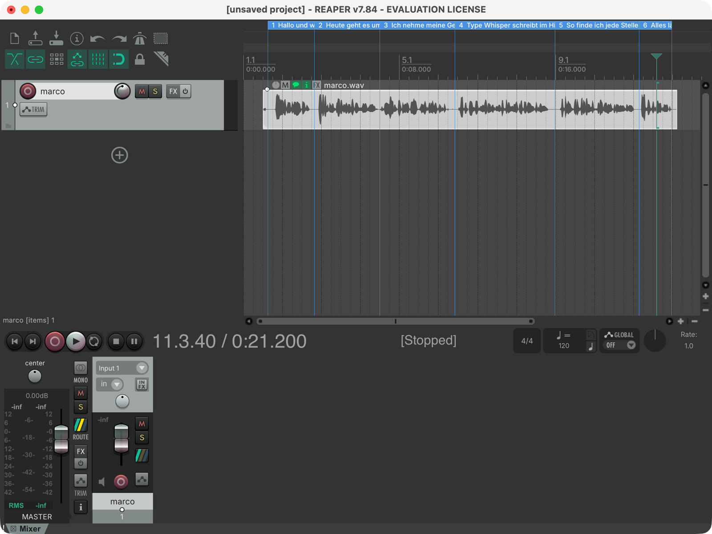
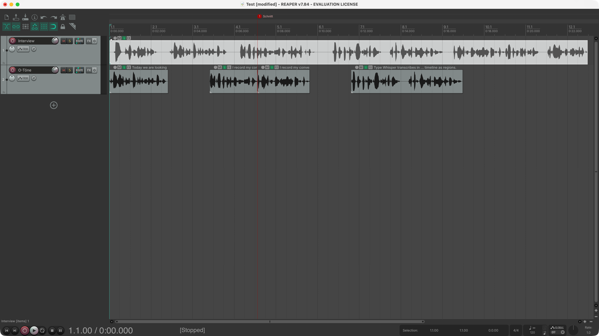

# TypeWhisper for REAPER

Two ReaScripts: one transcribes your recordings with TypeWhisper, the other cuts the passages you mark in the transcript into finished quotes.

## Transcribe selected items

A ReaScript that sends the selected audio items to TypeWhisper on your Mac and adds the transcript to your REAPER project. REAPER stays usable while TypeWhisper works in the background.

- Regions on the timeline, formed from sentences and speaker changes, placed at the right time even for trimmed or moved items
- The audible text of each item in its notes
- A transcript file per recording (`<recording> - transcript.txt`, with timestamps and speakers) and a program text of all selected items in timeline order (`<project> - program text.txt`), both next to the project
- Running it again replaces only the regions it created before (your own regions stay, whatever their color); unchanged files come from the cache (`TypeWhisper/` next to the project)

## Requirements

- TypeWhisper for macOS, running
- Settings > Advanced > API Server turned on
- An engine with timestamps for regions and item notes, for example Parakeet or WhisperKit. Engines without timestamps only fill the transcript file.
- Speaker labels (A:, B:) need TypeWhisper Premium

## Installation

1. Copy `TypeWhisper_Transcribe selected items.lua` and `TypeWhisper_Cut quotes from transcript.lua` to `~/Library/Application Support/REAPER/Scripts/`.
2. In REAPER, open Actions > Show action list > New action > Load ReaScript and choose each file.
3. Optional: assign a keyboard shortcut or toolbar button.

## Usage

Select one or more audio items and run `Script: TypeWhisper_Transcribe selected items.lua`. A short dialog asks for:

- **Language**: `de`, `en`, … or `auto`. Stored per track. With items on tracks with different languages it shows `per track`.
- **Engine** and **Model**: empty uses the TypeWhisper settings, for example `parakeet` and `parakeet-tdt-0.6b-v3`.
- **Speakers**: `y` adds A:, B: to regions and notes.

Further settings (regions, notes, files, cache, minimum region length, pause length) are at the top of the script.

## Cut quotes from transcript

Cuts the passages you marked in a transcript into finished quotes on their own track ("Quotes", or "O-Töne" when the interview track is set to German).

1. Transcribe the interview with "Transcribe selected items" (version 0.2.1 or later). It writes `<recording> - transcript.txt` next to the project and keeps the word timestamps in `TypeWhisper/latest/`.
2. Open the transcript in any text editor and put `[[` and `]]` around each passage you want as a quote. Passages with the same number, for example `[[1: We didn't know back then]]` at minute 12 and `[[1: how big it would get]]` at minute 22, become one quote in the order they appear.
3. Save the file and run `Script: TypeWhisper_Cut quotes from transcript.lua`.

What it does:

- Finds each passage by its words. Small edits in the passage are fine; the script reports passages it matched with differences or could not find.
- Starts each quote in the pause before its first word and ends it in the pause after its last word. The cut points are checked against the audio, so a soft onset or a last syllable that the transcript timing misses stays in, and the neighbouring words stay out.
- Adds 10 ms fades, a 30 ms crossfade at the joints of a combined quote and a "Cut" ("Schnitt") marker at each joint.
- Names each quote after its first and last words, for example "We didn't know … how big it would get".
- Puts new quotes after the existing ones on the track, two seconds apart.

Needs word timestamps: TypeWhisper 1.8.2 with an engine that reports them, such as Parakeet or ElevenLabs Scribe.

## Notes

- Each source file is transcribed once, even when it is cut into many items.
- Long recordings: TypeWhisper reads the file directly, there is no size limit. Older TypeWhisper versions fall back to an upload of up to 256 MB.
- The language setting is a hint. Parakeet can still switch languages in mixed or unclear passages.
- macOS only.

## Changes

- Cut quotes from transcript 0.1.0: first version.
- Transcribe selected items 0.2.1: speaker labels also with word timestamps (words take the speaker of their segment); inside a sentence only a pause of 3 seconds starts a new region, so regions end at sentence ends instead of breathing pauses; a new run replaces only the regions this script created (stored by region number and start in the project), not every region in its color; keeps the latest transcript of each recording for the quote script.
- Transcribe selected items 0.2.0: direct file access instead of upload, one request per source file with cache, sentence-based regions, item notes with only the audible text, language per track, speaker labels, progress window, transcript and program text files, replaces its own regions on a new run.
- Transcribe selected items 0.1.0: first version.

## License

MIT, see [LICENSE](LICENSE).
